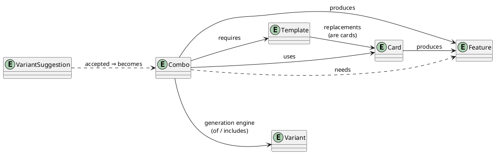

# Domain Model

Everything in Commander Spellbook is built from a small vocabulary. Learn these six concepts and the rest of the codebase reads easily. The models live in [`backend/spellbook/models/`](https://github.com/SpaceCowMedia/commander-spellbook-backend/tree/master/backend/spellbook/models).

## The core concepts

### Card

A Magic card, mirrored from [Scryfall](https://scryfall.com/) and keyed by `oracle_id` (synced by the `update_cards` task). A Card entity mirrors an **oracle card** — the game-rules identity shared by every printing — **not a specific reprint**: there is one `Card` per oracle card, regardless of how many times it has been printed. The table holds **every** oracle card Scryfall knows, so that a decklist resolves whole; the ones an editor has **curated** carry a compact `number`, and that number — not the primary key — is what every other model references, what a variant id is built from, and what the API calls the card's `id`. An editor curates a card with the action on the card list, and can enter one Scryfall has not published yet: it simply has no `oracle_id` until a later sync adopts it by name. Beyond its name it carries the Magic characteristics used for filtering and validation — color identity, mana value, type line, oracle text, keywords — inherited from the abstract **`Playable`** base. A card can *produce features* directly (e.g. a card that by itself is "an extra turn").

### Feature

A **named effect or result** — the abstraction that lets the engine chain things together. Examples: `Infinite mana`, `Untap target permanent`, `Win the game`. Cards and combos *produce* features; combos *need* features. A feature's **status** decides how it is treated and shown:

| Status | Meaning |
|--------|---------|
| Hidden / Public utility | Intermediate building block used only by the engine (public ones are visible to combo submitters) |
| Helper | A reusable effect meant to be exploited by other combos |
| Contextual | Situational effect |
| Standalone | A meaningful, usually game-impacting result |

Features can be marked **uncountable** (only ever one copy — this also speeds up generation).

### Template

A **placeholder for "any card matching a query"**, e.g. *"a creature with power 4 or greater"*. A template is defined **either** by a [Scryfall-style search query](api.md#the-search-query-language) **or** by an explicit list of concrete **replacements** (cards known to satisfy it) — **not both**. Either way the replacements are ordinary **Cards**. Templates let a combo be written generically; the engine expands them into real cards.

Both kinds resolve to the same relation, `matches`, recomputed by the card sync and whenever a template is edited: a query is evaluated locally against the card table, a replacement list is taken as written. That is what lets a deck be told how many copies of a template it actually holds, rather than assuming a query template is always available.

### Combo

The **editor-authored interaction** — the input to the engine. A combo is a *recipe* that declares:

- **uses** — cards it needs (`CardInCombo`)
- **requires** — templates it needs (`TemplateInCombo`)
- **needs** — features it consumes as prerequisites (`FeatureNeededInCombo`)
- **produces** — features it results in (`FeatureProducedInCombo`)
- **removes** — features it invalidates (`FeatureRemovedInCombo`)

plus editorial text (mana needed, prerequisites, step-by-step description, notes). A combo's **status** controls its role in generation — most importantly `GENERATOR` (a combo that variants are generated *from*) versus `UTILITY` (a building block that only exists to be chained into others).

### Variant

A **concrete, fully-resolved card combination** produced by the engine — the primary object the API serves. Where a combo may say "a mana dork + Isochron Scepter", a variant names the exact cards. Each variant records the generator combos it is `of`, the combos it `includes`, the cards it `uses`, the templates it `requires`, and the features it `produces`, and adds derived data: color identity, mana cost, popularity, a power **bracket** estimate, and a review **status** (only `OK` and `EXAMPLE` variants are public). Variant output is **pre-serialized/denormalized** on save so reads are fast.

### Suggestions

Community-submitted content that waits for editor review before it becomes canonical:

- **VariantSuggestion** — a combo submitted by a user. Editors review it and, if accepted, turn it into a real Combo.
- **VariantUpdateSuggestion** — proposed edits to existing variants.
- **VariantAlias** — a redirect from an old or alternative id to a canonical variant, so links never break.

## How they relate

The **feature** is the pivot: a card or combo *produces* a feature, and another combo *needs* it. Chaining "produces → needs" across the graph is exactly what the [variant generation engine](variant-generation.md) walks.

## Shared building blocks

A few abstract models and join tables recur throughout:

- **`Recipe`** — the abstract `uses` / `requires` / `produces` structure and automatic name generation, shared by `Combo`, `Variant`, and `VariantSuggestion`.
- **`Playable`** — Magic characteristics (color identity, mana value, type line, …) shared by `Card` and `Variant`.
- **`Ingredient` / `OrderedIngredient`** — the through-model base that carries per-item data such as `quantity` and starting **zone locations** (hand, battlefield, graveyard, …).

## The `[[ ]]` reference syntax

Text fields (descriptions, prerequisites, notes, starting card states) reference the features their combo needs with `[[feature]]`, which writes the names of whatever produces the feature in the variant: the card producing it, or every ingredient of the combo producing it and of whatever that combo needs in turn, joined as a sentence ("A, B and C"). The other parts are optional and come in this order: `[[feature#face$selector@key|alias]]`. This lets editorial prose refer to generated pieces without hardcoding card names. Every character of the syntax is defined once, at the top of `spellbook/models/references.py`, which builds the patterns, the validators and the editors' help text from them; a feature name holds none of `! # $ @ | [ ]` and an attribute name none of `$ @ | [ ]`, since they delimit the parts of a reference.

**Keys.** Whatever produces a feature provides a dictionary of keys. The built-in ones hold a text or a list of texts: `name`, and the texts that variants write under the names of their fields (`mana_needed`, `easy_prerequisites`, `notable_prerequisites`, `description`, `notes`, `comment`). Every other key is a **feature attribute**, which has to exist in the attribute admin first. A producer (a card feature, or the row a combo produces a feature with) holds the attributes it produces the feature with, each giving an optional text, kept on the relationship between the producer and the attribute rather than in its dictionary; the admin edits both in the same editor, an attribute with no text written as `Landfall: null`. Writing an attribute does not require it: `[[feature@effect]]` writes the text of whatever producer the row gets, and a row can still require the attribute among all of its attributes to keep out the producers without it. The dictionary of a row of a combo overrides an attribute like any key. A card feature has nothing but its `dictionary` and its attributes for all of it, besides the card naming it: its texts reach the variants needing it like the ones of a combo, while an attribute, such as the `effect` holding what the card does when it produces the feature, is written only where a combo references it. A combo provides its own text fields, and defines keys on the row of each feature it produces, on top of what its ingredients and the features it needs bring. `[[feature@key]]` writes a key: a list reads as a sentence, the texts of a field combine the way that field does (lines for a description, symbols added up for mana), and a key nothing provides writes nothing. In the admin a dictionary is edited key by key, or whole as YAML or JSON.

**References to the field they are in.** `[[feature@description]]` in a description, or `[[feature@battlefield_card_state]]` in a battlefield state, writes in place the texts of that field taken from whatever produces the feature and from everything it needs in turn. Those texts are then not appended to the variant's own, while the references they hold are written in turn, even when that writes a text twice. A reference to another field of the variant, as `[[feature@mana_needed]]` in a description, writes it inline and leaves it appended. A reference left with nothing to write is deleted without touching the text around it, and a line the deletion leaves empty goes away with it.

**Dictionaries override what an ingredient brings.** The dictionary of a card, template or needed feature row of a combo overrides what that row brings to the features the combo produces and to its variants: a text replaces the value of its key, a blank text leaves it out, and a list adds to a list (names and texts are lists, the texts of a combo lists of one) or replaces a text. `{"name": ""}` on a card keeps it out of the names, and `{"mana_needed": ""}` on a needed feature keeps the mana of whatever the variant holds only to satisfy that row out of the variant, as for a spell the combo casts for free. The row a combo produces a feature with overrides what the combo provides for that feature the same way, its own texts included, wherever the combo writes as its producer: for the combos needing the feature, and in the variants showing it as a result, where a combo making several results whose rows override a key differently writes every override. Nothing else keeps out what the variant holds for its own sake: its generator combos, and whatever produces a feature that is no utility, or removes one the variant produces. The texts of the combo owning a row still reference the feature whole, and starting locations and card states are inherited either way.

A combo may only reference the features it needs, and its texts only see the copies its **needed feature** rows accept: a card the variant holds for another reason, producing the feature with attributes the combo rules out, is never named by them. A card feature needs no feature, so neither its texts nor its dictionary can reference any. The admin refuses a save breaking either rule.

The selector is either a number or an attribute name. A number counts through the copies the combo owning the text needs of that feature, row after row, so when each row needs one copy `[[name$2]]` always means "whatever satisfies the second row", in every variant of that combo — the rows are drag-sortable in the admin, and a number past the copies the combo needs is refused. An attribute name, as in `[[name$Landfall]]`, picks the copy produced with that attribute regardless of any ordering, and no selector picks every copy the rows of the combo were dealt. The starting location override of a needed feature row reaches the same copies, so what `[[name$2]]` names starts where the second row asks, and a copy left over starts where every row accepting it asks. A copy left over is written the same way: a reference without a selector to a text such as `@description` writes it too, next to the copies dealt, instead of the variant appending it on its own. `[[feature|alias]]`, always written last, names the reference so that the same text can repeat it as `[[!alias]]`, or with another key as `[[!alias@key]]`, before or after the definition. Renaming a feature or a feature attribute in the admin rewrites the references to it across every text field and dictionary.

`[[#Z]]`, `[[#+X]]` and `[[#-Y]]` point at the Zth line of their own text, the line X lines below and the one Y lines above, and each variant replaces them with the number that line ends up at, once the texts written around it have moved it. Aliases and line references have prefixes of their own so that they never collide with feature names, which hold none of them.

## Where to go next

The [Variant Generation](variant-generation.md) page explains how the engine turns these combos into variants.
